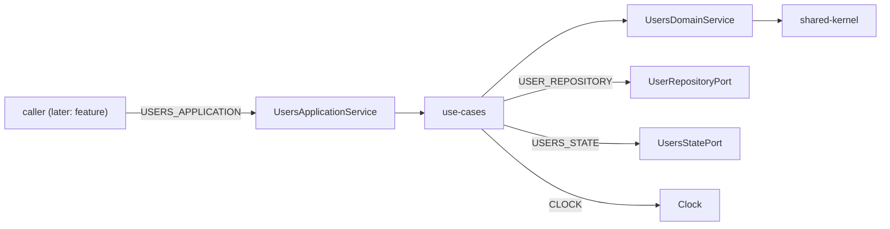

# Design

## Context

See proposal.md for motivation. Constraints that shape the approach:

- ADR-0001 already enforces `type:domain` → kernel only and `type:application` → domain + kernel (+ util/contracts, unused here). `scope:users` may depend on `scope:users` and `scope:shared`.
- ADR-0002 defines one kernel entry with symbol-level purity checks. Domain functions receive `now` as an argument. Application services inject the shared token.
- Engineering conventions: anemic `User`, one domain service, ports in application, single driving port, `UseCaseCall`, backend as source of truth, no DTO/mappers in application, mocks in `application/mock`.
- Test runner for new libs is `@angular/build:unit-test` (same as `shared-kernel` / `shell`). Do not add vite/vitest workspace plugins.
- Pre-existing: `shell:test` reports "No tests found". Do not put it in verification tasks.

Kernel primitives already exist: `Result`, `DomainError`, `Id<Brand>`, `DomainEvent`, `Clock` / `systemClock` / `fixedClock`.

## Goals / Non-Goals

**Goals:**

- Two Nx libraries (`users-domain`, `users-application`) that later infrastructure and feature can bind and consume.
- Ports and mocks stable enough that `users-infrastructure` only implements them.
- Application unit tests run against `application/mock` with no HTTP and no SignalStore.

**Non-Goals:**

- HTTP adapters, SignalStore, UI, feature, remote, event bus, contracts, publishing.
- Activating a user through the driving port (domain still has `activate`; the port exposes `deactivate` only).
- Distinguishing sibling infrastructure libraries (later change).

## Key decisions

### Two libraries, not one

Domain must stay framework-free (`pureConventions`). Application needs `inject`, `InjectionToken` and `Signal`. One library could not satisfy both lint variants. Tags: `users-domain` = `type:domain` + `scope:users`; `users-application` = `type:application` + `scope:users`. Aliases: `@showtime/users/domain`, `@showtime/users/application`, `@showtime/users/application/mock`.

### Anemic `User` plus one domain service

`User` is `Readonly<{ id: UserId; email: Email; fullName: FullName; role: UserRole; status: UserStatus }>`. `UserDraft` is `Omit<User, 'id'>`. Value types: `Email` / `FullName` (smart constructors → `Result`), `UserId` (`asUserId` cast), `UserRole` = `UserRoleEnum` (`Admin = 'admin'`, `Member = 'member'`), `UserStatus` = `UserStatusEnum` (`Active = 'active'`, `Inactive = 'inactive'`) (type guards, no constructor).

`UsersDomainService` is a stateless object of functions (no `inject`): `createUserDraft`, `userRegistered`, `activate`, `deactivate`, `rename`, `changeRole`. Structural validators stay private in that file. No `policies/` folder.

Use `Object.freeze` for records produced by the domain service, alongside readonly types, to satisfy the frozen-record requirement without class wrappers. A service input shape stays local to its function/file; the domain never imports application `NewUser`. Public email/full-name smart constructors delegate to the service-owned structural validation rather than duplicating its rules.

### Ports in application

Driven: `UserRepositoryPort` + `USER_REPOSITORY`; `UsersStatePort` + `USERS_STATE`. Driving: `UsersApplicationPort` + `USERS_APPLICATION`. `UsersApplicationService` implements the driving port and is not exported from the barrel.

Repository methods return `Promise<Result<T, UsersError>>`. No `remove`. State port: `users: Signal<User[]>`, `total: Signal<number>`, `setPage(users, total)`. Last `UsersQuery` for reload is a private field on the application service (not on the state port).

The public barrel exports the driving contract and consumer models, plus driven contracts/tokens needed by later adapters. Consumers providing a fixed clock use the shared `CLOCK` token. Any compatibility re-export refers to the same declaration. It does not export the facade or use-case classes. `provideUsersApplication()` registers the facade and internal use-cases but does not bind repository or state implementations. Tests bind those separately through `provideUsersPortsMock()`.

Alternatives considered: combining domain/application would couple structural rules to Angular; exporting individual use-cases would couple consumers to orchestration details. Separate libraries with one driving port preserve both boundaries with the existing Nx tag rules (ADR-0003).

### Statuses on the facade

Each Users command returns `UseCaseCall<T, UsersError>`. Its status and `listStatus` use `OperationStatus<UsersError>`. The facade delegates independent command-call lifecycles to the shared `runUseCase` helper; list-call signals remain local. Race: a generation counter on `load`; a stale result is `cancelled` and skips `setPage`. After successful `create` / `update` / `deactivate`, the service calls `load` with the last query (no-op reload if `load` was never called).

The facade owns list request arbitration and is the only place that authorizes a loaded page to be written. Internal load use-cases return repository results without writing state before this check. Superseding a load marks the previous call cancelled immediately; its eventual result cannot change state or the latest `listStatus`. Cancellation is a call status, not a new `UsersError` kind. Mutation success reflects persistence; a subsequent reload failure is reported by `listStatus` and does not retroactively turn a saved mutation into failure.

Use-cases orchestrate promised port results directly under the explicit `UseCaseCall` contract. No resource-driven automatic fetch, RxJS bridge, event bus, or event publishing is introduced. Registration events are constructed only after repository creation supplies the id; transition events remain domain facts returned internally until a real subscriber exists.

`UpdateUser` (application model) is `{ id: UserId; fullName: string; role: string }`. The update use-case loads the user, applies `rename` and `changeRole`, then `save`.

### Shared kernel public entry

Keep one Nx project and one public entry, `@showtime/shared/kernel`. Export pure primitives and `OperationStatus<E>` and the pure `OperationStatusEnum` alongside the root `CLOCK` token and `UseCaseCall<T, E>`. The call contract exposes a read-only `Signal<OperationStatus<E>>` and a `Promise<Result<T, E>>`.

Group definitions by purpose under `src/lib/types/`, `enums/`, `tokens/`, `constants/` and `utils/`, with one named folder and colocated tests per entity. `Clock` and `fixedClock` remain in `types/clock`, `CLOCK` lives in `tokens/clock`, and `systemClock` in `constants/clock`. The barrel exports these authoritative definitions.

Nx tags enforce project boundaries; lint additionally follows named symbols and their transitive dependencies, including renamed imports and intermediary re-exports. Domain and framework-free kernel sources cannot reach Angular or RxJS. Namespace imports and export-all from the mixed barrel are conservatively rejected there. Angular core is permitted only in tokens, the `UseCaseCall` contract and the named `utils/run-use-case/run-use-case.ts` helper, with core testing helpers in their colocated specs. Other utilities remain framework-free. RxJS is forbidden throughout kernel. The public barrel may re-export the Angular contracts.

This keeps one token identity and one call contract without a secondary alias or an additional project. A cross-context neutral contract belongs in kernel; context-specific errors, events and ports stay with their owner.

### Clock token

```ts
export const CLOCK = new InjectionToken<Clock>('CLOCK', {
  providedIn: 'root',
  factory: () => systemClock,
});
```

Use-cases import `CLOCK` from `@showtime/shared/kernel`, call `inject(CLOCK)` and pass `now` into the domain. Tests override `CLOCK` with `fixedClock(...)`. No `provideClock()`.

### Mocks as a path, not a third Nx project

`libs/users/application/src/mock/` is mapped as `@showtime/users/application/mock`. It is not a separate project (YAGNI). Existing `conventions` already forbid that import outside `*.spec.ts` and `mock/` files.

### Scaffolding

Use `@nx/angular:library` (non-buildable) then switch the test target to `@angular/build:unit-test` with a `test-build` target, copying `shared-kernel`. Domain eslint spreads `pureConventions` and has no Angular runtime dependency. Application eslint spreads `conventions` and may depend on `@angular/core` only.

## Data flow



This change ships in-memory mocks of the two driven ports. Real adapters arrive in `users-infrastructure`.

## Folder layout

```text
libs/users/
  domain/                         # users-domain
    src/lib/
      models/user.ts              # User, UserDraft
      value-objects/              # user-id, email, full-name, user-role, user-status
      services/users-domain.ts
      events/                     # user-registered, user-activated, user-deactivated, user-renamed, user-role-changed
      errors/                     # invalid-email, invalid-full-name, invalid-role
    src/index.ts
  application/                    # users-application
    src/lib/
      models/                     # new-user, update-user, users-query, users-page, users-error
      ports/driving/users-application.port.ts
      ports/driven/               # user.repository.port.ts, users-state.port.ts
      services/users-application.service.ts
      use-cases/commands/         # load-users, get-user, create-user, update-user, deactivate-user
      use-cases/queries/users-view.ts
      providers/provide-users-application.ts
    src/mock/                     # @showtime/users/application/mock
    src/index.ts
```

Each domain/application module that is more than a type alias lives in its own folder, matching the kernel layout.

Owned Angular 22 components omit redundant `ChangeDetectionStrategy.OnPush` metadata and its unused import. Preserve explicit non-default overrides. Update lint and engineering guidance to accept the implicit default, and leave generated spartan code outside the migration.

## Risks / Trade-offs

- [Ports exist before adapters] → Contract suites in `application/mock` freeze the port shape; infrastructure must pass the same suites.
- [Last query lives in the facade] → Lost on service recreate; acceptable until a composition root provides the service per remote. Do not put query on the state port.
- [Activate exists in domain but not on the driving port] → YAGNI; add a command when a scenario needs it.
- [Email rule is structural only] → Backend remains source of uniqueness; conflict kind still handled when adapters exist.
- [shell:test still empty] → Exclude `shell` from `test` in the final verification task (same as users-foundation decision B).

## Migration Plan

1. Generate domain, implement model/VOs/service/events, tests.
2. Generate application, ports, facade, use-cases, mocks, tests.
3. Consolidate kernel definitions, wire the single public entry and symbol-level import boundaries, and update Users to consume the shared contracts.
4. Align Angular component conventions, then verify impacted workspace projects.
5. Wire aliases and confirm `nx lint/test` on the two projects plus `npm run test:lint`.
Rollback: revert the commits; no runtime app is wired yet.

## Open Questions

None. Role/status literals, draft default `active`, and the update shape are fixed above.

## Decisions

- [ADR-0001](../../../docs/adr/0001-layer-and-scope-tags-with-enforced-dependency-rule.md): layer and scope tags; domain and application libraries inherit the existing `depConstraints`.
- [ADR-0002](../../../docs/adr/0002-framework-free-shared-kernel.md): one public entry exports shared contracts with symbol-level purity enforcement.
- [ADR-0003](../../../docs/adr/0003-users-model-and-application-ports.md): immutable plain users models, pure domain behavior, and application-owned ports with composition-root binding.

The approved operation lifecycle enum is defined in `enums/operation-status/operation-status.enum.ts` with `Idle`, `Loading`, `Success`, `Error` and `Cancelled` members preserving the lowercase runtime values. `OperationStatus<E>` uses these members as discriminants; only `Error` carries the mandatory `error: E`. The separately approved Users-owned `UserRoleEnum` preserves `admin` and `member`; `UserRole` aliases it and application re-exports the same enum. The approved Users-owned `UserStatusEnum` preserves `active` and `inactive`; `UserStatus` aliases it and application re-exports the same enum.
