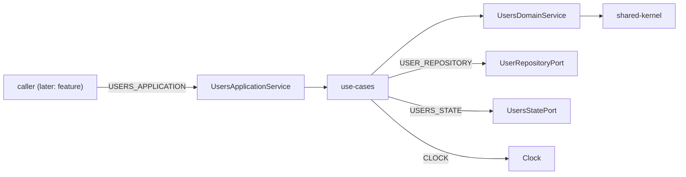

# Design

## Context

See proposal.md for motivation. Constraints that shape the approach:

- ADR-0001 already enforces `type:domain` → kernel only and `type:application` → domain + kernel (+ util/contracts, unused here). `scope:users` may depend on `scope:users` and `scope:shared`.
- ADR-0002: kernel `Clock` has no DI token; domain functions take `now` as an argument; the token lives in application.
- Engineering conventions: anemic `User`, one domain service, ports in application, single driving port, `UseCaseCall`, backend as source of truth, no DTO/mappers in application, mocks in `application/mock`.
- Test runner for new libs is `@angular/build:unit-test` (same as `shared-kernel` / `shell`). Do not add vite/vitest workspace plugins.
- Pre-existing: `shell:test` reports "No tests found". Do not put it in verification tasks.

Kernel primitives already exist: `Result`, `DomainError`, `Id<Brand>`, `DomainEvent`, `Clock` / `systemClock` / `fixedClock`.

## Goals / Non-Goals

**Goals:**

- Two Nx libraries (`users-domain`, `users-application`) that later infrastructure and feature can bind and consume.
- Ports and mocks stable enough that `users-infrastructure` only implements them.
- Application unit tests run against `application/mock` with no HTTP and no SignalStore.

**Non-Goals:**

- HTTP adapters, SignalStore, UI, feature, remote, event bus, contracts, publishing.
- Activating a user through the driving port (domain still has `activate`; the port exposes `deactivate` only).
- Distinguishing sibling infrastructure libraries (later change).

## Key decisions

### Two libraries, not one

Domain must stay framework-free (`pureConventions`). Application needs `inject`, `InjectionToken` and `Signal`. One library could not satisfy both lint variants. Tags: `users-domain` = `type:domain` + `scope:users`; `users-application` = `type:application` + `scope:users`. Aliases: `@showtime/users/domain`, `@showtime/users/application`, `@showtime/users/application/mock`.

### Anemic `User` plus one domain service

`User` is `Readonly<{ id: UserId; email: Email; fullName: FullName; role: UserRole; status: UserStatus }>`. `UserDraft` is `Omit<User, 'id'>`. Value types: `Email` / `FullName` (smart constructors → `Result`), `UserId` (`asUserId` cast), `UserRole` = `'admin' | 'member'`, `UserStatus` = `'active' | 'inactive'` (type guards, no constructor).

`UsersDomainService` is a stateless object of functions (no `inject`): `createUserDraft`, `userRegistered`, `activate`, `deactivate`, `rename`, `changeRole`. Structural validators stay private in that file. No `policies/` folder.

### Ports in application

Driven: `UserRepositoryPort` + `USER_REPOSITORY`; `UsersStatePort` + `USERS_STATE`. Driving: `UsersApplicationPort` + `USERS_APPLICATION`. `UsersApplicationService` implements the driving port and is not exported from the barrel.

Repository methods return `Promise<Result<T, UsersError>>`. No `remove`. State port: `users: Signal<User[]>`, `total: Signal<number>`, `setPage(users, total)`. Last `UsersQuery` for reload is a private field on the application service (not on the state port).

### Statuses on the facade

Each driving command returns `UseCaseCall<T>`. The service allocates a `signal<OperationStatus>` per call. Race: a generation counter on `load`; a stale result is `cancelled` and skips `setPage`. After successful `create` / `update` / `deactivate`, the service calls `load` with the last query (no-op reload if `load` was never called).

`UpdateUser` (application model) is `{ id: UserId; fullName: string; role: string }`. The update use-case loads the user, applies `rename` and `changeRole`, then `save`.

### Clock token

```ts
export const CLOCK = new InjectionToken<Clock>('CLOCK', {
  providedIn: 'root',
  factory: () => systemClock,
});
```

Use-cases `inject(CLOCK)` and pass `now` into the domain. Tests override `CLOCK` with `fixedClock(...)`. No `provideClock()`.

### Mocks as a path, not a third Nx project

`libs/users/application/src/mock/` is mapped as `@showtime/users/application/mock`. It is not a separate project (YAGNI). Existing `conventions` already forbid that import outside `*.spec.ts` and `mock/` files.

### Scaffolding

Use `@nx/angular:library` (non-buildable) then switch the test target to `@angular/build:unit-test` with a `test-build` target, copying `shared-kernel`. Domain eslint spreads `pureConventions` and has no Angular runtime dependency. Application eslint spreads `conventions` and may depend on `@angular/core` only.

## Data flow



This change ships in-memory mocks of the two driven ports. Real adapters arrive in `users-infrastructure`.

## Folder layout

```text
libs/users/
  domain/                         # users-domain
    src/lib/
      models/user.ts              # User, UserDraft
      value-objects/              # user-id, email, full-name, user-role, user-status
      services/users-domain.ts
      events/                     # user-registered, user-activated, user-deactivated, user-renamed, user-role-changed
      errors/                     # invalid-email, invalid-full-name, invalid-role
    src/index.ts
  application/                    # users-application
    src/lib/
      models/                     # new-user, update-user, users-query, users-page, users-error, operation-status, use-case-call
      ports/driving/users-application.port.ts
      ports/driven/               # user.repository.port.ts, users-state.port.ts
      services/users-application.service.ts
      use-cases/commands/         # load-users, get-user, create-user, update-user, deactivate-user
      use-cases/queries/users-view.ts
      clock/clock.token.ts
      providers/provide-users-application.ts
    src/mock/                     # @showtime/users/application/mock
    src/index.ts
```

Each domain/application module that is more than a type alias lives in its own folder, matching the kernel layout.

## Risks / Trade-offs

- [Ports exist before adapters] → Contract suites in `application/mock` freeze the port shape; infrastructure must pass the same suites.
- [Last query lives in the facade] → Lost on service recreate; acceptable until a composition root provides the service per remote. Do not put query on the state port.
- [Activate exists in domain but not on the driving port] → YAGNI; add a command when a scenario needs it.
- [Email rule is structural only] → Backend remains source of uniqueness; conflict kind still handled when adapters exist.
- [shell:test still empty] → Exclude `shell` from `test` in the final verification task (same as users-foundation decision B).

## Migration Plan

1. Generate domain, implement model/VOs/service/events, tests.
2. Generate application, ports, facade, use-cases, mocks, tests.
3. Wire aliases and confirm `nx lint/test` on the two projects plus `npm run test:lint`.
Rollback: revert the commits; no runtime app is wired yet.

## Open Questions

None. Role/status literals, draft default `active`, and the update shape are fixed above.

## Decisions

- [ADR-0001](../../../docs/adr/0001-layer-and-scope-tags-with-enforced-dependency-rule.md): layer and scope tags; domain and application libraries inherit the existing `depConstraints`.
- [ADR-0002](../../../docs/adr/0002-framework-free-shared-kernel.md): kernel stays framework-free; `CLOCK` token is declared in application.

Candidate ADRs for the architect during `/ship` (not written now): anemic `User` with a stateless domain service; ports declared in `application/ports` and bound only in the composition root.
