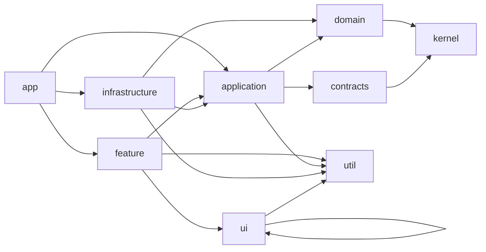

# Design

## Context

Current state (see proposal.md for motivation):

- Nx workspace with `shell` (app), `layout` (`libs/layout/ui`), `shared-spartan-ui` (barrel `@shared/spartan-ui` over ~60 helm libs) and `shared-styles`. Only `shared-styles` has tags (`type:util`, `scope:shared`).
- `eslint.config.mjs` configures `@nx/enforce-module-boundaries` with a single permissive rule (`*` -> `*`).
- `eslint.conventions.mjs` already exports `conventions` and `infrastructureConventions` (restricted imports: forms, `toSignal`/`toObservable`, `@spartan-ng/helm/*`, `@ngrx/*` except `@ngrx/signals` for infrastructure, `application/mock` outside specs). `shell` and `layout` already spread `conventions`; spartan libs are exempt.
- There are no kernel or shared UI libraries. Conventions live in `.cursor/rules/engineering-conventions.mdc`.

Constraint: the dependency rule must be machine-enforced from the first library, because later changes (domain, application, infrastructure, ui, feature, remote app) rely on it.

## Goals / Non-Goals

**Goals:**
- Tag taxonomy and `depConstraints` that encode the layer and scope rules from the specs.
- Framework-free lint variant for domain-like layers.
- `shared/kernel` and `shared/ui` libraries with aliases, ready for the next changes.
- Verification of the rules that does not depend on the later libraries.

**Non-Goals:**
- Any `users` library, the remote app, federation, event bus, contracts, command bus.
- Distinguishing sibling infrastructure libraries (`api` vs `state`) from each other: needs a finer tag and is decided in the infrastructure change.
- Visual redesign of existing layout components.

## Key Decisions

### Tag taxonomy

- `type:*`: `app`, `feature`, `ui`, `application`, `domain`, `infrastructure`, `contracts`, `util`, `kernel`.
- `scope:*`: `shell`, `layout`, `shared`, `users` (new contexts add their own scope).
- Tags per project: `shell` = `type:app`, `scope:shell`; `layout` = `type:ui`, `scope:layout`; `shared-spartan-ui` = `type:ui`, `scope:shared`; `shared-styles` unchanged; `shared-kernel` = `type:kernel`, `scope:shared`; `shared-ui` = `type:ui`, `scope:shared`.
- `kernel` is a separate type from `util`: domain may depend on kernel but not on util (utilities may use frameworks).

### depConstraints

Nx evaluates every constraint whose `sourceTag` matches a project (AND semantics), so layer and scope rules are separate entries:

| sourceTag | onlyDependOnLibsWithTags |
|---|---|
| `type:domain` | `type:domain`, `type:kernel` |
| `type:application` | `type:domain`, `type:kernel`, `type:util`, `type:contracts` |
| `type:infrastructure` | `type:domain`, `type:application`, `type:kernel`, `type:util` |
| `type:feature` | `type:application`, `type:ui`, `type:util` |
| `type:ui` | `type:ui`, `type:util` |
| `type:util` | `type:util` |
| `type:kernel` | `type:kernel` |
| `type:contracts` | `type:kernel`, `type:contracts` |
| `type:app` | `*` (restricted only by scope) |
| `scope:shared` | `scope:shared` |
| `scope:layout` | `scope:layout`, `scope:shared` |
| `scope:shell` | `scope:shell`, `scope:layout`, `scope:shared` |
| `scope:users` | `scope:users`, `scope:shared`, `type:contracts` |

Notes: `type:ui` -> `type:ui` is needed because shared UI and spartan UI are both `type:ui`; the `scope:users` entry admits any `type:contracts` library of other scopes. The rule list lives in its own module (`eslint.depconstraints.mjs`) imported by `eslint.config.mjs`, so a test can import it without running ESLint.

### Framework-free variant

`eslint.conventions.mjs` gains `pureConventions` (= `conventions` plus restricted `@angular/*` and `rxjs`), spread by `type:domain` and `type:kernel` libraries. Alternative (a single rule for everyone) was rejected: ui, application and feature legitimately use Angular.

### Verification strategy

- Tag check: Nx constraints apply only to tagged sources, so an untagged project would escape them. `tools/lint/check-tags.mjs` reads every `project.json` under `apps/` and `libs/` and fails when a project lacks a `type:*` or `scope:*` tag; wired as `npm run lint:tags` and covered by a Node test with fixture project files. (Importing an untagged project from a tagged one is already rejected by `onlyDependOnLibsWithTags`.)
- Boundary matrix test: a Node test (`node --test`, no new dependency) imports the exported `depConstraints` and asserts the allowed/rejected layer and scope pairs from the specs.
- Restricted-import test: Node test that runs the ESLint Node API on inline sources for `conventions`, `infrastructureConventions` and `pureConventions` (the same check already used to validate the `@ngrx` negation patterns).
- Real enforcement: `npx nx lint` on all projects after tagging must stay green.
- Limitation: end-to-end "lint rejects this import between two real libs" is covered later when the real libraries exist; no throw-away libraries are generated for this change.

### Kernel library

`libs/shared/kernel` (`@showtime/shared/kernel`), generated with the Nx Angular/JS library generator (non-buildable, `type:kernel`, `scope:shared`, lint with `pureConventions`). Contents (design-level shape):

- `Result<T, E>`: discriminated union on `ok`, with `ok()` and `err()` constructors.
- `DomainError`: `{ code: string; message: string }`.
- `Id<Brand>`: branded string type, plain string at runtime.
- `DomainEvent`: `{ readonly type: string; readonly occurredAt: string }`.
- `Clock`: `{ now(): string }` plus a system implementation and a fixed implementation for tests. No `InjectionToken` here (kernel is framework-free); the DI token belongs to the application layer in a later change.

### Shared UI library

`libs/shared/ui` (`@shared/ui`), generated with the Angular library generator (standalone components, `OnPush`, selector prefix `st-`, `type:ui`, `scope:shared`, lint with `conventions`). Components use only `@shared/spartan-ui` primitives (`badge`, `alert-dialog`, `empty`, `spinner`) and Tailwind classes with `hlm(...)`.

- `StatusBadge`: inputs `label` (required) and `tone` (default `neutral`).
- `ConfirmDialog`: model `open`, inputs `title`, `description`, `confirmLabel`, outputs `confirmed`, `cancelled`; Escape and cancel emit `cancelled`.
- `QueryState`: inputs `loading`, `error` (`string | null`), `empty`; content projection; precedence loading, error, empty, content.

Why shared from the start: they carry no domain knowledge and are certain to be reused (see engineering conventions); `SearchField`, `Pagination`, `DataTable` wait for a second consumer (YAGNI).

### Aliases

`tsconfig.base.json` paths: `@showtime/shared/kernel` -> `libs/shared/kernel/src/index.ts`, `@shared/ui` -> `libs/shared/ui/src/index.ts`. Generators must be allowed to add them; no manual duplicates.

## Risks / Trade-offs

- [Tagging reveals an existing violation] -> Run `npx nx lint` before and after tagging; current imports (`shell` -> `layout`, `layout` -> `shared-spartan-ui`) are allowed by the table.
- [Negated import patterns behave differently across ESLint versions] -> The restricted-import test pins the behavior (already verified once for the `@ngrx` patterns).
- [`type:ui` -> `type:ui` is broad] -> Scope constraints still stop cross-context UI imports; dumb-ness of context UI libs (no application/domain imports) is enforced by the layer table.
- [Sibling infrastructure libs are not separated yet] -> Documented non-goal; handled with an extra tag in the infrastructure change.
- [Constraints in a separate module are easy to forget in new configs] -> `eslint.config.mjs` is the single consumer; new libs inherit through the root config.
- [Stale lint cache after editing rule modules] -> add `eslint.conventions.mjs` and `eslint.depconstraints.mjs` to the `@nx/eslint:lint` inputs in `nx.json` (ST-0003) and run lint once with `--skip-nx-cache` after the change.

## Migration Plan

1. Tag projects and enable constraints in one commit; fix any lint violation in the same commit.
2. Add `pureConventions` and tests.
3. Generate the kernel and shared UI libraries.
Rollback: revert the commit(s); no runtime artifacts are affected.

## Architecture refinement

Dependency direction between layers (`type:*`); scope rules (`scope:*`) are applied on top and are not drawn:

Edges that are omitted in the diagram but allowed by the table: `infrastructure`/`application` -> `kernel`, `app` -> any. The foundation change introduces only the `kernel`, `ui` and `util` nodes; the others are validated by the matrix test until the users libraries exist.

Lint cache invalidation (found while exploring): `@nx/eslint:lint` inputs in `nx.json` list only `{workspaceRoot}/eslint.config.mjs`, not `eslint.conventions.mjs` (already imported by project configs) nor the new `eslint.depconstraints.mjs`. A changed rule would be served from the Nx cache. The same task that introduces `eslint.depconstraints.mjs` (ST-0003) must add both files to the `@nx/eslint:lint` `inputs` in `nx.json` (this is the "`nx.json` if required" case already named in proposal Impact) and verify with `npx nx show project layout --json` that the lint target lists them. No spec or task text changes; this is an implementation detail of ST-0003.

Other design notes:

- `type:util` and `scope:shared` for `shared-styles` stay as they are; the `scope:shared` entry means shared libraries never depend on `layout`, `shell` or `users`.
- `eslint.depconstraints.mjs` exports plain data only (no ESLint imports), so the matrix test (ST-0004) can import it directly.
- `pureConventions` is also meant for future `type:domain` libraries (see ADR-0002); the users domain change must spread it.
- Alias naming is inconsistent by existing choice (`@showtime/shared/kernel`, `@showtime/layout/ui` vs `@shared/ui`, `@shared/spartan-ui`); the aliases follow the engineering conventions and are not renamed here.

Candidate users-architecture ADRs (not written now; the decisions are already fixed in the engineering conventions, so each ADR is a record to write once the corresponding library exists): domain as anemic immutable data with stateless domain services; ports declared in `application/ports` and bound only in the composition root (`apps/users`); state split (SignalStore behind a state port, plain-signal UI services, `UseCaseCall` statuses); integration events via `contracts` and the shared event bus; `<Context>Error` model. Authors: architect, in the `users-domain-application` and `users-infrastructure` changes.

## Decisions

- [ADR-0001](../../../docs/adr/0001-layer-and-scope-tags-with-enforced-dependency-rule.md): `type:*`/`scope:*` tag taxonomy, layer and scope `depConstraints`, tag check, rule module separate from the ESLint config, lint cache inputs.
- [ADR-0002](../../../docs/adr/0002-framework-free-shared-kernel.md): framework-free `type:kernel` library separate from `util`, `pureConventions`, `Clock` without a DI token.

No ADR for `shared/ui`: its scope and dependency limits are fixed by the engineering conventions and ADR-0001.
